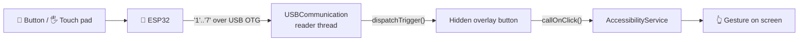

<div align="center">

# 📱🔘 SerialTouch

### Real buttons and a touch pad on the back of your phone.

**An ESP32 hidden inside a phone cover. Press, swipe, and your Android phone reacts.**


[What it is](#-what-is-this) •
[Controls](#-controls) •
[Hardware](#-the-hardware) •
[Getting started](#-getting-started) •
[How it works](#-how-it-works) •
[Hack it](#-adding-your-own-action)

</div>

---

## 🧩 What is this?

SerialTouch turns a regular phone cover into a controller. Inside the cover sits an **ESP32**, a **touch pad**, and a row of **physical buttons**. The cover plugs into the phone over USB OTG and sends one character per action. The Android app catches that character and performs a real tap, swipe, scroll, or Home press on the screen.

```
 ┌──────────────── the cover ────────────────┐
 │                                           │          ┌──────────────┐
 │   [ ● ]  [ ● ]  [ ● ]  ← physical buttons │          │              │
 │                                           │   USB    │   Android    │
 │   ┌───────────────────┐                   │   OTG    │    phone     │
 │   │    touch  pad     │  ← swipe / tap    │ ───────► │              │
 │   └───────────────────┘                   │  '1'..'7'│  👆 gesture  │
 │                 ESP32                     │          │              │
 └───────────────────────────────────────────┘          └──────────────┘
```

### Why you'd want one

<table>
<tr>
<td align="center" width="25%">🧤<br><b>Gloves on</b><br><sub>Scroll and tap in winter without taking them off</sub></td>
<td align="center" width="25%">💔<br><b>Cracked screen</b><br><sub>Keep using a phone whose touch layer is dying</sub></td>
<td align="center" width="25%">🤚<br><b>One hand</b><br><sub>Control the phone from the back with your fingertips</sub></td>
<td align="center" width="25%">♿<br><b>Accessibility</b><br><sub>Big, clicky buttons for people who find the glass hard to use</sub></td>
</tr>
</table>

## ✨ Highlights

- 🔌 **Plug in and go.** The app finds the cover and connects as soon as it's attached.
- ♻️ **Reconnects by itself.** Pull the cable or reset the ESP32, and a watchdog tries again every 3 seconds.
- 👆 **Seven actions:** tap, double tap, Home, scroll up, scroll down, swipe left, swipe right.
- 👻 **Nothing on screen.** Gestures go through a hidden accessibility overlay, so no floating UI covers your apps.
- 📡 **One byte per action.** You can debug the whole protocol from a serial monitor.
- 🛠️ **Easy to extend.** A new action needs one hidden button and one `case` statement.

## 🎮 Controls

The cover sends a single ASCII digit for each action:

| Byte | Action         | What happens on the phone                  |
|:----:|----------------|--------------------------------------------|
| `1`  | 👆 Tap         | Single tap at the center of the screen     |
| `2`  | ✌️ Double tap  | Two quick taps at the center               |
| `3`  | 🏠 Home        | Goes to the home screen                    |
| `4`  | ⬆️ Scroll up   | Scrolls the first scrollable view backward |
| `5`  | ⬇️ Scroll down | Scrolls the first scrollable view forward  |
| `6`  | ⬅️ Swipe left  | Horizontal swipe, right to left            |
| `7`  | ➡️ Swipe right | Horizontal swipe, left to right            |

> **Serial settings:** `2400` baud · `8` data bits · `1` stop bit · no parity (8N1)
>
> Any other byte is ignored, so stray newlines or debug prints from the ESP32 won't trigger anything.

## 🔧 The hardware

| Part                | Role                                                  |
|---------------------|-------------------------------------------------------|
| 🧠 ESP32            | Reads the buttons and touch pad, sends bytes over USB |
| 🔘 Physical buttons | Discrete actions such as tap, Home, and double tap    |
| 🖐️ Touch pad        | Swipe and scroll gestures                             |
| 🔌 USB OTG cable    | Power and serial data between the cover and the phone |

The phone powers the ESP32 through the OTG cable, so the cover needs no battery.

<details>
<summary><b>📟 Example ESP32 firmware (click to expand)</b></summary>

<br>

This sketch shows the pattern: buttons on GPIO pins with pull-ups, and the ESP32's built-in capacitive touch pins for the pad. Change the pins, threshold, and mapping to match your cover.

```cpp
// Buttons: wired between the GPIO pin and GND.
const int  BUTTON_PINS[]  = {25, 26, 27};
const char BUTTON_CODES[] = {'1', '2', '3'};      // tap, double tap, home

// Touch pad: ESP32 capacitive touch pins (T0 = GPIO4, T3 = GPIO15, ...).
const int  TOUCH_PINS[]   = {T0, T3, T4, T5};
const char TOUCH_CODES[]  = {'4', '5', '6', '7'}; // scroll up/down, swipe left/right
const int  TOUCH_THRESHOLD = 30;                  // lower reading = touched

void setup() {
  Serial.begin(2400);
  for (int pin : BUTTON_PINS) pinMode(pin, INPUT_PULLUP);
}

void loop() {
  for (int i = 0; i < 3; i++) {
    if (digitalRead(BUTTON_PINS[i]) == LOW) {
      Serial.print(BUTTON_CODES[i]);
      delay(200);                                 // simple debounce
    }
  }
  for (int i = 0; i < 4; i++) {
    if (touchRead(TOUCH_PINS[i]) < TOUCH_THRESHOLD) {
      Serial.print(TOUCH_CODES[i]);
      delay(250);
    }
  }
}
```

</details>

## 🚀 Getting started

### What you need

- 🛠️ Android Studio (AGP 8.8, JDK 11+)
- 📱 An Android 12+ phone (API 31) with USB host support
- 🧠 The ESP32 cover, or any ESP32 board for testing
- 🔌 A USB OTG cable or adapter

### Build and install

```bash
git clone https://github.com/DanielJacksonRSA/CoverApp.git
cd CoverApp
./gradlew installDebug
```

`local.properties` is not committed. Android Studio creates it for you, or you can add one with `sdk.dir=/path/to/Android/sdk`.

### Turn it on

1. Open **SerialTouch** and tap **Enable SerialTouch**.
2. Go to **Settings → Accessibility → SerialTouch Controller** and turn the service on.
3. Plug in the cover and tap **Allow** on the USB permission prompt.
4. Press a button. The phone responds. 🎉

> [!IMPORTANT]
> **Set your vendor ID first.** The app only connects to a USB device with a specific vendor ID, and two files set it separately:
>
> | Where | Current value | What it controls |
> |---|---|---|
> | `CONTROLLER_VENDOR_ID` in `USBCommunication.java` | `5824` (`0x16C0`) | Which device the app connects to |
> | `res/xml/device_filter.xml` | `6790` (`0x1A86`, CH340) | The "open app on attach" prompt |
>
> ESP32 boards usually use a USB-serial chip such as a CH340 (`0x1A86`), CP2102 (`0x10C4`), or the ESP32-S3's native USB (`0x303A`). Check your board's vendor ID with `lsusb` or a USB info app, then set **both** values to it.

## 🧠 How it works



```
app/src/main/java/com/example/coverapp/
├── MainActivity.java          Start screen, opens Accessibility settings
├── AccessibilityService.java  Hidden overlay, gestures, global actions
└── USBCommunication.java      USB discovery, reconnect watchdog, byte → action
```

1. **The overlay starts.** When the accessibility service connects, it inflates a hidden overlay (`floating_bar.xml`) with one button per action. Each button is wired to a gesture or global action.
2. **The USB link opens.** `USBCommunication.start(...)` finds the ESP32, opens the serial port using [usb-serial-for-android](https://github.com/mik3y/usb-serial-for-android), and starts a reader thread.
3. **The byte is dispatched.** Each digit maps to one overlay button. The app clicks it on the UI thread, and the gesture runs.

The USB code never calls gesture APIs directly. It only clicks the hidden buttons, which keeps the input side and the action side separate.

## 🎛️ Tuning

Each setting is a constant at the top of its class:

| Constant                | File                        | Default | Purpose                            |
|-------------------------|-----------------------------|---------|------------------------------------|
| `CONTROLLER_VENDOR_ID`  | `USBCommunication.java`     | `5824`  | USB vendor ID to connect to        |
| `BAUD_RATE`             | `USBCommunication.java`     | `2400`  | Serial speed (must match firmware) |
| `RECONNECTION_DELAY_MS` | `USBCommunication.java`     | `3000`  | Time between reconnect attempts    |
| `TAP_DURATION_MS`       | `AccessibilityService.java` | `100`   | Length of a tap                    |
| `SWIPE_DURATION_MS`     | `AccessibilityService.java` | `500`   | Length of a swipe                  |

Swipes use fixed pixel coordinates at `y = 1000` (left: `1000 → 100`, right: `300 → 1000`). On small or unusual screens, adjust the values in `bindButtons()`.

## 🩺 Troubleshooting

| Symptom | Likely cause | Fix |
|---|---|---|
| Nothing happens when the cover is plugged in | Vendor ID mismatch | Set `CONTROLLER_VENDOR_ID` and `device_filter.xml` to your board's ID |
| Connected, but buttons do nothing | Baud rate mismatch | Make sure the firmware uses `Serial.begin(2400)` |
| Gestures stop after a while | Accessibility service was killed | Turn **SerialTouch Controller** off and on again in Accessibility settings |
| Scroll does nothing | The current screen has no scrollable view | Try a list or feed app |
| Swipes land in the wrong place | Fixed coordinates don't fit your screen | Adjust the swipe values in `bindButtons()` |

## ➕ Adding your own action

1. Add a hidden button to `res/layout/floating_bar.xml`.
2. Bind it in `AccessibilityService.bindButtons()` as a `static Button` and give it a click listener.
3. Add a `case` for your new byte in `USBCommunication.dispatchTrigger(...)`.
4. Send that byte from the ESP32.

> 💡 **Quick first change:** the overlay already has **Power menu** and **Volume up** buttons wired to actions but not mapped to a byte. Map them to `'8'` and `'9'`.

## 🔒 Permissions and privacy

SerialTouch runs as an AccessibilityService, which is a powerful permission. The app uses it for two things only: performing gestures, and reading the view hierarchy to find something to scroll. It does not log, store, or send your screen content anywhere. As with any accessibility app, read the source before you enable it.

## 📄 License

All rights reserved. See [LICENSE](LICENSE).

<div align="center">

---

**Built with an ESP32, a phone cover, and a lot of soldering. 🔥**

⭐ If you like the idea, star the repo.

</div>
